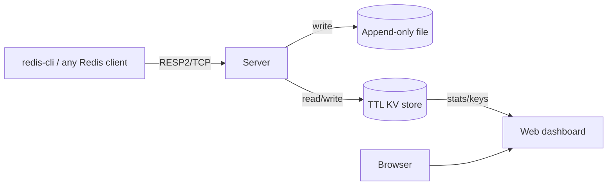

# CacheNova


**A Redis-compatible in-memory cache in Go — with durability and a live dashboard.**

CacheNova speaks the Redis Serialization Protocol (RESP2), so `redis-cli` and every standard Redis client library connect to it unchanged. It's built for teams that need caching, session storage, or rate-limit counters but don't want to pay for a managed cache. It ships as one small container and runs happily on **AWS ECS/Fargate for a few dollars a month**.

> Why it exists: a small e-commerce site needs fast session/cart storage and rate limiting. Instead of provisioning ElastiCache, they drop in CacheNova, point their existing Redis client at it, and get durability via an append-only file.

---

## What makes it interesting (engineering)

- **RESP2 parser written from scratch** (`internal/resp`) — handles simple strings, errors, integers, bulk strings, arrays, and inline commands. No Redis library involved; it's genuinely wire-compatible.
- **TTL with lazy + active expiration** — keys expire on access *and* via a background sweeper, exactly like Redis, so memory doesn't leak from untouched expired keys.
- **Append-only-file durability** — every write is logged as RESP and replayed on startup, so a restarted container recovers its full state (verified in tests and by hand).
- **Atomic counters** — `INCR`/`DECR` are safe under concurrency, making CacheNova usable as a rate-limiter backend.
- **Race-tested** — the server is covered by integration tests run under `-race`.

## Supported commands

`PING` · `ECHO` · `SET key val [EX s | PX ms]` · `GET` · `DEL` · `EXISTS` · `INCR` · `DECR` · `TTL`

## Architecture



## Quick start

```bash
docker compose up --build
```

- Dashboard: http://localhost:8080
- Cache: `redis-cli -p 6380`

```bash
redis-cli -p 6380 set user:1 alice EX 60
redis-cli -p 6380 get user:1
redis-cli -p 6380 incr page:views
redis-cli -p 6380 ttl user:1
```

Watch the dashboard update keys, TTLs, and hit-rate live.

## Run locally without Docker

```bash
go build -o cachenova ./cmd/cachenova
./cachenova --resp :6380 --http :8080 --aof ./cache.aof
```

Restart it and the keys come back — that's the AOF replay.

## Tests

```bash
go test ./... -race
```

Covers SET/GET/DEL/EXISTS, atomic INCR/DECR, PX/EX expiry, and PING.

## Development

Common tasks are wrapped in a `Makefile` (`make help` lists everything):

```bash
make check            # lint (vet + gofmt) and run tests with the race detector
make race             # tests under the race detector
make run              # run the service locally
make frontend-dev     # Vite dev server for the React/TS dashboard
make up               # docker compose up --build
```

## Deploying to AWS ECS/Fargate

1. Push the image to ECR (see FlagForge README for the exact commands).
2. Attach an **EFS volume** mounted at `/data` so the AOF survives task restarts.
3. Expose `:6380` to your app tasks (private) and `:8080` behind an ALB for the dashboard.
4. 0.25 vCPU / 0.5 GB is plenty for tens of thousands of keys.

## Project layout

```
cmd/cachenova       entrypoint
internal/resp       RESP2 protocol parser/encoder
internal/store      TTL-aware concurrent KV store
internal/server     TCP server, command dispatch, AOF
internal/dashboard  stats + key-browser HTTP API
web/static          live dashboard (Tailwind CDN)
```

## License

MIT
